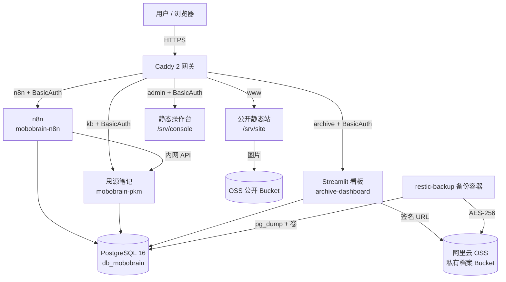

# 莫伯（MoBo）双站系统

> MoBoBrain 知识库与内容自动化中枢 × Wolfram 式计算型个人数字档案系统  
> 项目源库 / 架构基线 / 部署交付物 / 运维手册

---

## 1. 项目是什么

本仓库是 `莫伯双站系统全栈架构与部署总册` 的工程化落地版本，目标是在一台阿里云 2 核 4GB 主机上，以 Docker Compose 运行两个逻辑隔离的网站：

| 站点 | 定位 | 核心技术 | 访问策略 |
|---|---|---|---|
| **网站 A：MoBoBrain** | 知识库、研究资料、内容生产与自动化 | 思源笔记 + n8n + PostgreSQL + 思源 API | `www` 公开只读；`kb`、`n8n`、`admin` 强认证 |
| **网站 B：个人数字档案** | 时间线、阅读、运动、复盘、数字资产 | PostgreSQL 16 + pgvector + Streamlit | `archive` 强认证，默认全私有 |

统一基础设施：Caddy 2 网关、PostgreSQL 16（pgvector）单实例双库、阿里云 OSS 双 Bucket 冷热分层、Restic 每日加密备份。

---

## 2. 当前状态

- **阶段**：Phase 0–4 交付物完成；Phase 5 骨架就绪（n8n 模板、公开站占位页）；Phase 6 待外部资源
- **已完成**：目录体系、v1.1 总册、治理/需求/架构/数据库/运维/合规文档、数据库 `01~06` DDL、Compose/Caddy/备份/灾备/加固脚本、看板、CLI、迁移/沙盒/测试、n8n 模板
- **待验证**：本机无 Docker/Python，`docker compose config`、容器初始化、Smoke Test、`pytest` 尚未在本机执行；统一在 T-08/T-10 执行
- **未完成**：云端采购与备案、n8n 导入联调、公开站真实构建、真实环境联调、恢复演练、上线验收
- **生产可用性**：**尚未达到**。所有密钥均为占位符，部署前必须按 `docs/05-运维与灾备/部署手册.md` 完成替换与验收。

---

## 3. 目录导航

```text
.
├─ README.md                     # 本文件
├─ docker-compose.yml            # 单机双站编排入口（部署时位于 /opt/mobo-stack）
├─ .env.example                  # 环境变量模板，不含真实密钥
├─ docs/
│  ├─ 00-总册/                   # v1.1 主文档、修订记录、术语表
│  ├─ 01-项目治理/               # 章程、范围、WBS、风险、ADR
│  ├─ 02-需求与验收/             # 需求、NFR、测试、验收
│  ├─ 03-架构设计/               # 总体、网络与安全、数据、部署
│  ├─ 04-数据库设计/             # A/B 数据字典、触发器、迁移与备份
│  ├─ 05-运维与灾备/             # 部署、运维、监控、排障、演练、安全
│  └─ 06-合规与成本/             # ICP、隐私、成本、密钥
├─ deploy/
│  ├─ caddy/Caddyfile            # 网关与鉴权
│  ├─ postgres/initdb/           # 01~06 初始化 SQL
│  ├─ backup/                    # 备份镜像、每日备份、灾备恢复、演练
│  ├─ scripts/                   # OSS Guard、主机加固、Smoke Test
│  └─ volumes/                   # 运行时数据卷（Git 忽略）
├─ services/
│  ├─ archive-dashboard/         # Streamlit 看板
│  ├─ mobo-cli/                  # 本地/云端录入 CLI
│  └─ console/                   # 静态操作台
├─ workflows/                    # n8n 工作流与说明
├─ migrations/                   # 增量迁移
├─ seeds/                        # 沙盒与示例数据
└─ tests/                        # SQL / 集成 / 端到端测试
```

---

## 4. 架构一览



---

## 5. 关键设计决策

1. **一个主域名 + 多子域**：`www`、`kb`、`n8n`、`archive`、`admin` 分开，避免 n8n/思源子路径反代问题。
2. **公开站静态化**：网站 A 的公开内容由思源导出后构建为静态站，由 Caddy 直接托管，不增加运行时容器。
3. **单实例双库 + Schema 隔离**：`db_mobobrain` 内含 `intel`、`n8n` Schema；`db_archive` 内含 `archive` Schema。
4. **网站 B 全私有**：Caddy BasicAuth + TLS + `noindex`，数据库不暴露公网。
5. **备份与恢复分开验证**：每日 `pg_dump` + Restic；每季度做恢复演练；RPO 24h，RTO 分级。
6. **密钥不进 Git**：`.env` 权限 600，真实密钥只存服务器与密码管理器。

详见 `docs/01-项目治理/决策记录/`。

---

## 6. 快速开始（本地开发）

> 生产部署见 `docs/05-运维与灾备/部署手册.md`。本地开发需要 Docker Desktop（Windows）或 Docker Engine + Compose v2。

```bash
# 1. 复制环境变量模板
cp .env.example .env

# 2. 生成密码哈希与随机密钥（示例）
docker run --rm caddy:2.9-alpine caddy hash-password --plaintext '替换为你的强密码'
openssl rand -base64 32

# 3. 编辑 .env：至少替换所有 ChangeMe_*、域名、OSS 凭证
# 4. 启动
docker compose config
docker compose up -d --build

# 5. 查看状态
docker compose ps
docker stats --no-stream
```

本地没有 OSS 时，可先只启动 `postgres` 与 `archive-dashboard`，看板会自动切换到“52 周合成沙盒”模式。完整本地开发方案见 `docs/03-架构设计/部署架构.md`。

---

## 7. 安全提醒

- 仓库内**不得**提交 `.env`、AK/SK、Restic 密码、n8n 加密密钥、Bcrypt 哈希真实值。
- 网站 B 存储个人隐私数据，公网部署前必须完成：HTTPS、BasicAuth、`noindex`、SSH 加固、防火墙、备份演练。
- 阿里云 RAM 子账号不要使用 `AliyunOSSFullAccess`；应限制到两个 Bucket 与必要前缀。
- 首次上线前请阅读 `docs/05-运维与灾备/安全基线.md`。

---

## 8. 文档入口

- 主文档：[`docs/00-总册/莫伯双站系统全栈架构与部署总册-v1.1.md`](docs/00-总册/莫伯双站系统全栈架构与部署总册-v1.1.md)
- 项目章程：[`docs/01-项目治理/项目章程.md`](docs/01-项目治理/项目章程.md)
- 范围与边界：[`docs/01-项目治理/范围与边界.md`](docs/01-项目治理/范围与边界.md)
- 16 步实施计划：[`docs/01-项目治理/里程碑与WBS.md`](docs/01-项目治理/里程碑与WBS.md)
- 风险登记：[`docs/01-项目治理/风险登记册.md`](docs/01-项目治理/风险登记册.md)
- 总体架构：[`docs/03-架构设计/总体架构.md`](docs/03-架构设计/总体架构.md)
- 部署手册：[`docs/05-运维与灾备/部署手册.md`](docs/05-运维与灾备/部署手册.md)
- 备份与恢复：[`docs/05-运维与灾备/备份与恢复演练.md`](docs/05-运维与灾备/备份与恢复演练.md)

---

## 9. 版本

- 基线：`莫伯双站系统全栈架构与部署总册.docx`（2026-10-15，v1.0）
- 当前：v1.1 工程化基线（2026-10-20）
- 维护方式：文档与代码同仓，变更走 ADR / 修订记录。
