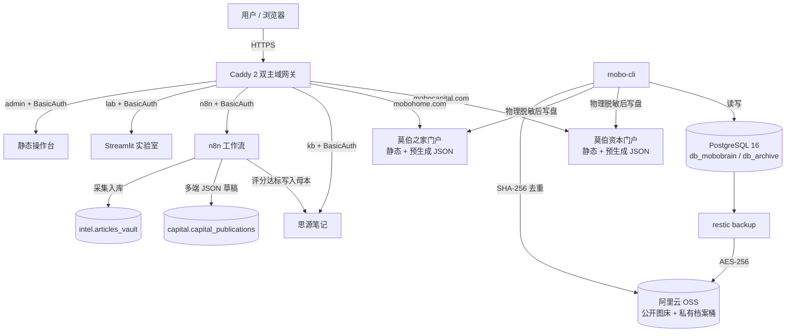

# 莫伯双站系统（MoBoCapital.com & MoBoHome.com）

> **莫伯资本**：全球宏观投研智库 · 对冲基金孵化蓝图 · 财经自媒体运营（六端错峰）  
> **莫伯之家**：个人主权数字档案馆 · Wolfram 式生命体征看板  
> 工程源库 · 架构基线 · 本地全栈 · 运维与合规交付物

**公开仓库**：[github.com/henrry179/mobo-capital-and-mobo-home](https://github.com/henrry179/mobo-capital-and-mobo-home)  
**GitHub Pages**：[henrry179.github.io/mobo-capital-and-mobo-home](https://henrry179.github.io/mobo-capital-and-mobo-home/)（`main` / root，已启用）

---

## 1. 系统是什么

一台 2 核 4GB 级主机上的 Docker Compose 六容器栈，承载两个逻辑独立、数据可恢复、可长期维护的网站：

| 站点 | 定位 | 数据底座 | 访问策略 |
| --- | --- | --- | --- |
| **网站 A：莫伯资本** | 投研智库、策略手册、实盘复盘与 NAV 风控、基金孵化蓝图、财经自媒体运营 | `db_mobobrain`（`intel` + `capital`） | 主站公开；`/internal/*` 强认证 |
| **网站 B：莫伯之家** | 人生叙事、影像画廊、藏书馆、阅读/运动/复盘与体征看板 | `db_archive`（`archive`） | 公开栏目 + `/internal/*` 强认证 |

统一基础设施：Caddy 2 双主域网关、PostgreSQL 16（pgvector）单实例双库、阿里云 OSS 双 Bucket 冷热分层、Restic 每日加密备份。当前阶段按 **本地优先（ADR-0010）** 在 WSL2 跑通，公网域名与 ICP 未启动。

---

## 2. 当前状态（2026-10-26）

| 项 | 说明 |
| --- | --- |
| **模式** | 本地优先 —— 不买云、不备案也能开发与验收 |
| **本地阶段** | **L0–L2、L4 完成**；L3（n8n/LLM）部分完成；L5 质量门部分通过；L6 公网就绪包材料已整理 |
| **门户** | 资本公域 JSON + `editorial.json`；之家公域叙事 / 图库 / 书单已恢复，无沙盒泄漏 |
| **GitHub Pages** | 仓库已公开；Pages 从 `main` `/` 部署；资本 / 之家 / 控制台 / 文档站可打开 |
| **资本第 5 栏** | **财经自媒体运营**（`/media-ops`）：六端错峰台账 + 数据模板 + 草稿预览 + 发布预览；本机浏览器台账，导出 CSV；**不自动发布** |
| **生产可用性** | **尚未达到**；密钥均为占位符，公网前须按部署手册替换并验收 |

**下一步入口**：[开发部署任务执行时间线](docs/01-项目治理/开发部署任务执行时间线.md) · [本地开发与部署](docs/05-运维与灾备/本地开发与部署.md) · [本地自检清单](docs/05-运维与灾备/本地阶段自检清单.md) · [任务账本](TASK_STATE.md) · [WSL2 运行时](tools/wsl/README.md)

### 2.1 财经自媒体运营（资本第 5 栏，2026-10-26）

莫伯资本门户 `sites/mobocapital/index.html` 第 5 栏由「自媒体引擎」改为 **财经自媒体运营**，路径仍为 `/media-ops`（`#media-ops`）。

| 块 | 作用 |
| --- | --- |
| **发布节奏** | 每天六端各一篇不同母稿；换平台 ≥3 天、目标约 4 天；头条 72h 首发与小红书原创优先；偶尔重复只留给微信 / 雪球 / 微博 |
| **发布台账** | 序号 / 日期 / 文章标题 / 平台 / 发布时间 / 选中书 /（X）英文标题；存本机 `localStorage`，可导入导出 CSV |
| **数据模板** | 微信、头条、微博、雪球、小红书、X 五档时间窗；账号合计只抄平台窗口数字，单篇不相加 |
| **草稿预览** | 官网 / 微信 / 雪球 / X 草稿；仍经 HITL 人工终审 |
| **发布预览** | 按文章标题分组，只读展示日 / 年 / 月日 / 平台 / 选中书 |

六端：微信公众号、今日头条、新浪微博、雪球、小红书、X（现阶段英文主发，母稿来自深度精读中文）。不写扫描脚本、不把台账做成仓库 JSON、不自动发帖。

---

## 3. 在线打开三个前端

各站 `index.html` 在子目录根，资源用相对路径。

### GitHub Pages（已启用）

当前 Source：**Deploy from a branch** · `main` · `/` (root)。推送 `main` 后约 1–2 分钟重建。

| 站点 | URL |
| --- | --- |
| 入口 | https://henrry179.github.io/mobo-capital-and-mobo-home/ |
| 莫伯资本 | https://henrry179.github.io/mobo-capital-and-mobo-home/sites/mobocapital/ |
| 资本 · 财经自媒体运营 | https://henrry179.github.io/mobo-capital-and-mobo-home/sites/mobocapital/#media-ops |
| 莫伯之家 | https://henrry179.github.io/mobo-capital-and-mobo-home/sites/mobohome/ |
| 控制台 | https://henrry179.github.io/mobo-capital-and-mobo-home/services/console/ |
| 工程文档站 | https://henrry179.github.io/mobo-capital-and-mobo-home/sites/docs-portal/ |

仓库已含根目录 `index.html`、`.nojekyll`。不要用 jsDelivr 打开 `.html`（会变成 `text/plain`）。若 Pages 被关掉，到 [Pages 设置](https://github.com/henrry179/mobo-capital-and-mobo-home/settings/pages) 按上表 Source 重新打开即可。

### 本机已可打开（推荐先看效果）

全栈起来后（`bash tools/wsl/wsl-up.sh`）：

| 站点 | 地址 |
| --- | --- |
| 莫伯资本 | http://localhost/ |
| 莫伯之家 | http://mobohome.localhost/ |
| 控制台 | http://admin.localhost/ |

或零依赖：`node tools/local-preview/start.js` → `8080` / `8081` / `8082`。

> 控制台在 `github.io` 下用相对路径读公域 JSON；本机 Caddy 仍走 `/api/...`。内域 JSON 与金库媒体不随公开仓分发。

---

## 4. 目录导航

```text
.
├─ README.md / TASK_STATE.md / .env.example
├─ index.html / .nojekyll          # GitHub Pages 入口
├─ docker-compose.yml              # 六容器 + 内存硬限流（冻结基线，勿随意改）
├─ docker-compose.local.yml / docker-compose.wsl.yml
├─ docs/                           # 总册附录、治理、需求、数据字典、运维、合规、原始资料
├─ deploy/                         # Caddy / postgres initdb / backup / scripts（冻结）
├─ services/
│  ├─ console/                     # 莫伯系统控制台（admin）
│  ├─ mobo-cli/                    # 投研录入 + 公私域脱敏导出
│  └─ archive-dashboard/           # Streamlit 生命体征实验室
├─ sites/
│  ├─ mobocapital/                 # 资本门户 + data/*.json；第 5 栏财经自媒体运营
│  ├─ mobohome/                    # 之家门户 + data/*.json（公域）
│  ├─ shared/                      # 页内文档查看器 / 分栏 docs-pane
│  └─ docs-portal/                 # 工程文档站入口 + catalog.json
├─ workflows/                      # n8n 模板（阶段二发布默认禁用）
├─ migrations/ seeds/ tests/
├─ server-sync-data/               # 小体积公域同步样例（非金库原件）
└─ tools/
   ├─ wsl/                         # WSL 起栈、质量门、状态收集
   ├─ local/                       # 公域种子 SQL、pending stub
   ├─ local-preview/               # 零依赖静态预览
   └─ vault/                       # 金库工具（金库本体在仓外）
```

大体积内容原料仓（`01-工作与项目/` 等）与金库 `MoBo-Content-Vault-v5` **gitignore / 仓外**，见 [推送规划](docs/00-总册/_inventory/github-push-plan-3gb-2026-10-24.md)。

---

## 5. 架构一览



---

## 6. 五条架构红线

1. **2C4G 内存硬限流**：六容器 `mem_limit` 合计约 1.64–1.84GB；前台静态化，服务端零额外渲染开销。
2. **PostgreSQL 双库物理隔离**：`user_mobobrain` 只读写 `db_mobobrain`，`user_archive` 只读写 `db_archive`；禁 FDW、禁超级用户跑业务。
3. **OSS 内网免流与冷热分层**：容器内强制 internal Endpoint；原件按前缀转冷，前端优先缩略图。
4. **公私域物理脱敏与三级权限**：`PUBLIC` / `LP_PROSPECT` / `INTERNAL`；公域包写盘前剔除私有字段；`/internal/*` 强制 BasicAuth。
5. **境内/境外双轨合规**：境内脱敏点位与收益承诺并强制免责声明；发布经人工终审（HITL）。

细则见 [生产级落地附录](docs/00-总册/生产级落地附录-v2.1.md) 与 [决策记录索引](docs/01-项目治理/决策记录/README.md)。

---

## 7. 快速开始（本地开发）

完整步骤：[本地开发与部署](docs/05-运维与灾备/本地开发与部署.md)。公网：[部署手册](docs/05-运维与灾备/部署手册.md)。

### 模式 A · 零依赖预览（Node.js）

```bash
node tools/local-preview/start.js
```

| 入口 | 地址 |
| --- | --- |
| 架构与入口总览 | http://127.0.0.1:8082/ |
| 莫伯资本 | http://127.0.0.1:8080/ |
| 莫伯之家 | http://127.0.0.1:8081/ |

### 模式 B · Docker 全栈（WSL2，本机主形态）

```bash
# 一次性：WSL 内安装 Docker Engine
bash tools/wsl/install-docker-in-wsl.sh

# 日常：起全栈
bash tools/wsl/wsl-up.sh
```

| 入口 | 地址 | 认证 |
| --- | --- | --- |
| 莫伯资本 | http://localhost/ | 公开 |
| 莫伯之家 | http://mobohome.localhost/ | 公开 |
| 生命体征实验室 | http://lab.localhost/ | BasicAuth |
| 思源 / n8n / 控制台 | kb / n8n / admin `.localhost` | BasicAuth |

本地 BasicAuth 默认见控制台「本地开发凭据」卡片或 `tools/wsl/write-local-credentials.sh`（**凭据文件不入库**）。

**通用 Docker Desktop / Linux：**

```bash
cp .env.example .env.local
docker compose -f docker-compose.yml -f docker-compose.local.yml --env-file .env.local up -d --build
docker compose -f docker-compose.yml -f docker-compose.local.yml --env-file .env.local exec -T postgres \
  psql -U postgres -d db_archive -f /tmp/smoke.sql
docker stats --no-stream   # 常驻宜 < 1.55GB
```

无 OSS 时看板可切「52 周合成沙盒」：

```bash
docker compose cp seeds/52-week-sandbox.sql postgres:/tmp/seed.sql
docker compose exec -T postgres psql -U postgres -d db_archive -f /tmp/seed.sql
```

### CLI 速查

```bash
cd services/mobo-cli && pip install -e ".[dev]"

mobo-cli doctor
mobo-cli export-site --site all          # 公私域数据包；写盘前脱敏审计
mobo-cli capital nav                     # NAV 与回撤熔断状态
```

公域种子（叙事 / 图库 / 书单等）见 `tools/local/seed_*.sql`。无 LLM 时可用 `tools/local/stage1_pending_stub.sql` 写入 `PENDING_REVIEW`。

---

## 8. 安全提醒

- 不得提交 `.env`、`.env.local`、AK/SK、Restic 密码、n8n 加密密钥、真实 Bcrypt、`credentials.local.json`。
- 网站 B 含个人隐私、网站 A 含实盘复盘：公网前必须完成 HTTPS、BasicAuth、`/internal`、SSH 加固、防火墙、脱敏审计与备份演练。
- 阿里云 RAM 子账号避免 `AliyunOSSFullAccess`。
- 境内发布须过 [证券与自媒体合规](docs/06-合规与成本/证券与自媒体合规.md) 清单。

---

## 9. 文档入口

| 主题 | 文档 |
| --- | --- |
| 总纲 | [总册 v2.1](docs/00-总册/莫伯双站系统全栈架构与部署总册-v2.1.md) · [整合总览](docs/00-总册/双站规划文档整合总览.md) · [生产级落地附录](docs/00-总册/生产级落地附录-v2.1.md) · [合并去重方案](docs/00-总册/文档合并去重方案.md) · [架构宪章 CLAUDE.md](CLAUDE.md) |
| 治理 | [章程](docs/01-项目治理/项目章程.md) · [范围与边界](docs/01-项目治理/范围与边界.md) · [WBS](docs/01-项目治理/里程碑与WBS.md) · [风险](docs/01-项目治理/风险登记册.md) · [执行时间线](docs/01-项目治理/开发部署任务执行时间线.md) · [ADR 索引](docs/01-项目治理/决策记录/README.md) |
| 架构 | [总体](docs/03-架构设计/总体架构.md) · [部署](docs/03-架构设计/部署架构.md) · [数据](docs/03-架构设计/数据架构.md) · [网络与安全](docs/03-架构设计/网络与安全架构.md) |
| 需求 | [需求规格](docs/02-需求与验收/需求规格说明书.md) · [NFR](docs/02-需求与验收/非功能需求.md) · [验收](docs/02-需求与验收/验收标准与DoD.md) · [测试计划](docs/02-需求与验收/测试计划.md) |
| 数据 | [总览](docs/04-数据库设计/README.md) · [资本字典](docs/04-数据库设计/莫伯资本数据字典.md) · [网站 A](docs/04-数据库设计/网站A数据字典.md) · [网站 B](docs/04-数据库设计/网站B数据字典.md) |
| 运维 | [部署手册](docs/05-运维与灾备/部署手册.md) · [本地开发](docs/05-运维与灾备/本地开发与部署.md) · [自检清单](docs/05-运维与灾备/本地阶段自检清单.md) · [日常运维](docs/05-运维与灾备/日常运维.md) · [监控](docs/05-运维与灾备/监控告警.md) · [排障](docs/05-运维与灾备/故障排查.md) · [备份演练](docs/05-运维与灾备/备份与恢复演练.md) · [安全基线](docs/05-运维与灾备/安全基线.md) |
| 合规 | [ICP](docs/06-合规与成本/ICP与域名材料清单.md) · [隐私](docs/06-合规与成本/隐私与数据分类.md) · [证券与自媒体](docs/06-合规与成本/证券与自媒体合规.md) · [成本](docs/06-合规与成本/成本台账.md) · [密钥清单](docs/06-合规与成本/密钥与凭据清单.md) |
| 内容金库 | [原始资料索引](docs/07-原始资料/README.md) · [方案-v5](docs/07-原始资料/莫伯双站原件保全与双站同步方案-v5.md) · [V5 执行报告](docs/07-原始资料/莫伯双站V5执行报告-2026-10-23.md) · [执行记录 10-24](docs/07-原始资料/执行记录-2026-10-24/) · [原始方案 Word 归档](docs/07-原始资料/原始方案/README.md) |

---

## 10. 版本

| 版本 | 说明 |
| --- | --- |
| v1.0 / v1.1 | 早期总册与工程化基线 —— 见 `docs/00-总册/归档/` |
| **v2.1** | 双主域 + 投研/自媒体/量化终端（当前基线） |
| v2.1.1 | Local-First：WSL2 全栈、公域门户、GitHub 公开工程仓与 Pages 入口 |
| v2.1.2 | 自金库恢复总册/ADR/docs03/CLAUDE/v5/整合总览；07 执行记录与 Word 归档说明 |
| v2.1.3 | 资本第 5 栏改为财经自媒体运营（六端错峰台账 / 数据模板 / 发布预览）；Pages 已部署 |

维护约定：文档与代码同仓；架构级变更先记 ADR；数据库变更走 `migrations/`；**Compose / Caddy / initdb / n8n 正文为冻结基线，非明确需求勿改。**
