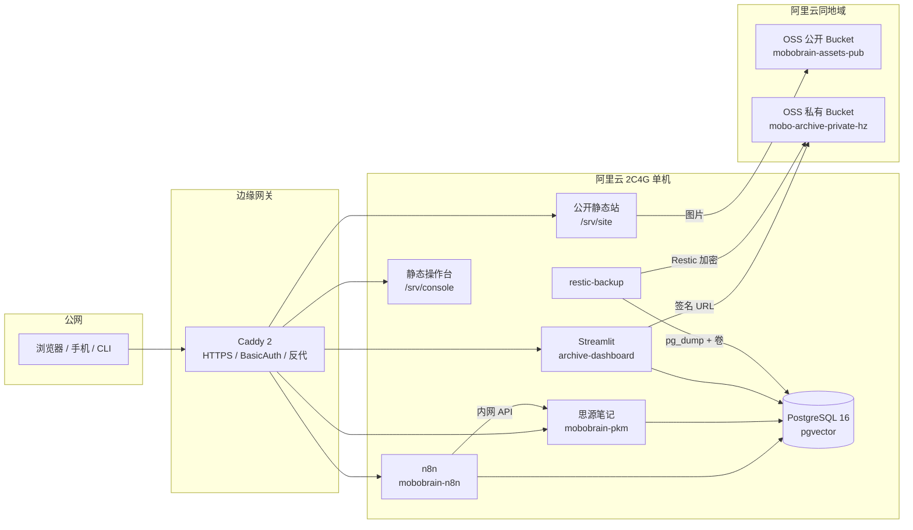

# 莫伯（MoBo）双站系统全栈架构与工程部署总册 v1.1

> **MoBoBrain 知识库与内容自动化中枢 × Wolfram 式计算型个人数字档案系统**  
> 从初始需求、云资源采购、数据库建模、n8n 工作流到异地灾备的工程化交付蓝图

| 文档属性 | 说明 |
|---|---|
| 基线来源 | `莫伯双站系统全栈架构与部署总册.docx`（2026-10-15，v1.0） |
| 本版日期 | 2026-10-20 |
| 架构原则 | 两个独立网站、统一管理基础设施、单机多容器逻辑硬隔离、数据三级冷热分层 |
| 年度预算红线 | 2,400 元/年以内（推荐配置首年约 935 元，次年约 1,355 元，保留机动余量） |
| 核心计算底座 | 阿里云 2 核 4GB Linux + 4GB Swap + 同地域 OSS |
| 软件栈 | Caddy 2 + PostgreSQL 16 (pgvector) + 思源笔记 + n8n + Streamlit + Python CLI + Restic |
| 文档状态 | 工程化基线，可进入实施；云端采购与备案尚未开始 |

---

## 0. 本版修订摘要

v1.1 不是对 v1.0 的简单排版，而是把“架构说明 + 代码节选”升级为“可执行、可验收、可运维”的项目基线。主要修订：

1. **补全 16 步**：v1.0 标题写 16 步，正文与配套仪表板只有 13 步。本版保留 T-01~T-13 为上线步骤，新增 T-14 监控告警、T-15 灾备演练、T-16 验收/成本对账/交接。
2. **修正网站 A 鉴权缺口**：v1.0 的 Caddyfile 将思源直接反代到根路径且无认证。本版改为 `www` 公开静态站 + `kb` 受保护思源 + `n8n` 受保护后台 + `admin` 操作台。
3. **修正 n8n 子路径问题**：v1.0 使用 `/n8n/*` 子路径但未配置 `N8N_PATH`。本版改用 `n8n.` 子域，并补齐 `N8N_HOST`、`WEBHOOK_URL`、`N8N_PROXY_HOPS`。
4. **补网站 A 数据模型**：新增 `intel.sources`、`articles_vault`、`content_drafts`、`ingestion_runs`、`llm_usage`。
5. **补数据库工程化能力**：新增增量迁移、只读账号、最小权限、HNSW 索引、中文检索降级方案、`updated_at` 触发器。
6. **修正备份链路**：备份容器改为自带 `restic` 与 `postgresql-client` 的自定义镜像；数据库使用 `pg_dump -Fc`，不直接备份运行中的 `pg_data`。
7. **修正灾备预期**：RPO 24h；RTO 分级为配置/数据库 ≤2h、文件数据 4–24h；每季度恢复演练。
8. **补齐运维与合规**：监控、日志轮转、SSH 加固、防火墙、fail2ban、ICP 材料清单、隐私数据分类、成本台账。

---

## 1. 项目定位与边界

### 1.1 两个独立网站

**网站 A：MoBoBrain 知识库系统（Personal Knowledge Base）**

- 内容生产与知识管理：自媒体文章、财经/产业研究资料、Markdown、PDF、图片、内容版本。
- 全文检索、标签分类、双链知识关联、AI 语义向量检索。
- 为自动化内容生产、研究资料管理、个人 Agent 提供数据底座。
- 主要负载：文本检索、数据库读写、文件上传、后台定时任务。

**网站 B：个人数字档案系统（Personal Digital Archive）**

- 个人信息与长期计算型存档：照片、视频、简历、个人文档、人生记录、阅读打卡、运动生理指标、结构化复盘。
- 按时间、主题、事件、文件类型建立多维索引。
- 构建 Stephen Wolfram 式 Personal Analytics 看板：周度节律、Z-Score、Lead-Lag 回归、时间线散点、资产总账。
- 主要负载：大文件冷热分层、元数据管理、跨维统计、加密备份。

### 1.2 三层“独立”

1. **网站独立**：不同域名/子域、不同容器、不同数据库实例或 Schema、不同鉴权策略。
2. **数据独立**：两站数据库与静态卷分别导出备份；上层应用损坏时，原始数据仍可恢复。
3. **物理资源按需独立**：初期共用一台 2C4G 主机；大文件剥离到 OSS；后期可平滑拆主机。

### 1.3 本期不做（Out of Scope）

- 多用户注册、评论、论坛、社区、UGC。
- 微信/雪球/X 的自动发布 API 对接（本期只生成草稿，人工审核发布）。
- 视频在线转码、完整 OCR 流水线、移动端原生 App。
- 多活、跨地域双写、Kubernetes、Serverless。
- 商业 SaaS 对外服务。

---

## 2. 关键参数基线

| 维度 | 网站 A | 网站 B | 落地要点 |
|---|---|---|---|
| 1–2 年存储量 | ≤50GB（实际 15–30GB） | 100–500GB | 照片/视频“标准层 WebP 缩略图 + 低频/归档原片” |
| 访问方式 | 部分公开，核心研究库私有 | 100% 私有 | `www` 公开；`kb/n8n/admin/archive` 强认证 |
| 数据库 | `db_mobobrain`（`intel`、`n8n` Schema） | `db_archive`（`archive` Schema） | 单 PostgreSQL 实例，双库硬隔离 |
| 向量维度 | 1536（基线，可迁移） | 1536（基线，可迁移） | 换模型必须改列类型并重建 HNSW |
| 备份 | 每日 03:00 | 每日 03:00 | `pg_dump -Fc` + Restic AES-256 |
| RPO / RTO | 24h / ≤2h | 24h / 2h（DB/配置）、4–24h（大文件） | 每季度演练 |

### 2.1 预算口径

| 费用项 | 首年参考 | 次年参考 | 说明 |
|---|---:|---:|---|
| 云服务器 2C4G | 200–500（均值 360） | 400–1,000（均值 720） | 优先 3 年连购锁价 |
| 域名 | 100–180（均值 130） | 150–240（均值 190） | 一个主域名 + 子域即可 |
| HTTPS | 0 | 0 | Caddy + Let's Encrypt |
| ICP/公安备案 | 0 | 0 | 官方免费 |
| OSS 容量+流量 | 100–300（均值 250） | 200–500（均值 280） | 三级分层 + 内网 Endpoint |
| 备份/快照 | 50–150（均值 80） | 100–200（均值 120） | Restic 走内网低频 |
| **合计** | **450–1,130（推荐 935）** | **850–1,940（推荐 1,355）** | 距 2,400 红线留 1,000+ 机动 |

> 配套仪表板按 300GB 测算为 795/1,215，与总册的 935/1,355 存在口径差异。以实际订单和 `docs/06-合规与成本/成本台账.md` 为准。

---

## 3. 总体架构

### 3.1 逻辑架构



### 3.2 域名与信任边界

| 子域 | 用途 | 认证 | 备注 |
|---|---|---|---|
| `www` | 网站 A 公开专栏/静态站 | 无 | 只读；CSP、缓存 |
| `kb` | 思源笔记知识库 | BasicAuth | 核心研究库，禁止匿名 |
| `n8n` | 自动化后台 | BasicAuth | 定时触发；Webhook 默认不公开 |
| `archive` | 网站 B 看板 | BasicAuth + `noindex` | 个人隐私，默认全私有 |
| `admin` | 静态操作台 | BasicAuth | 展示任务状态/快捷入口 |

> 不建议把思源或 n8n 挂在子路径：两者的静态资源、Webhook、WebSocket 对子路径敏感。子域方案更稳。

### 3.3 容器与内存预算

| 容器 | 角色 | 常驻估算 | 硬上限 | 网络 |
|---|---|---:|---:|---|
| `mobo-caddy` | 网关/HTTPS/鉴权 | ~45MB | 128m | `edge_net` + `internal_net`，仅暴露 80/443 |
| `mobo-postgres` | 双库数据底座 | ~380MB | 1024m | 仅 `internal_net`；宿主 `127.0.0.1:5432` |
| `mobobrain-pkm` | 思源笔记 | ~140MB | 512m | 仅 `internal_net` |
| `mobobrain-n8n` | 自动化 | ~320MB | 640m | 仅 `internal_net` |
| `archive-dashboard` | Streamlit | ~210MB | 512m | 仅 `internal_net` |
| `restic-backup` | 每日备份 | ~15MB | 256m | 仅 `internal_net` |
| **合计** | | **~1.46GB** | **3,072m** | 预留 OS/缓存/峰值 |

> 2C4G 的瓶颈不是常驻内存，而是 `docker compose build`、n8n 大批量执行、PostgreSQL 索引构建的峰值。构建应在本地/CI 完成；服务器只拉取镜像或使用预构建镜像；必须挂 4GB Swap。

---

## 4. 数据架构

### 4.1 数据库与 Schema

| 数据库 | Schema | 属主 | 用途 |
|---|---|---|---|
| `db_mobobrain` | `intel` | `user_mobobrain` | 情报源、文章库、草稿箱、采集运行、LLM 用量 |
| `db_mobobrain` | `n8n` | `user_n8n` | n8n 自身表，避免污染业务表 |
| `db_archive` | `archive` | `user_archive` | 时间线、阅读、运动、复盘、资产总账 |

只读账号：`user_dashboard_ro`（仅 `archive` SELECT）。备份账号：`user_backup`（`pg_read_all_data`）。应用账号不使用超级用户。

### 4.2 网站 B 五大模块

1. **统一时间线**：`timeline_events` + `entity_links`，万物映射为 `TIMESTAMPTZ` / `TSTZRANGE`。
2. **阅读**：`reading_items` + `reading_logs`，读完自动同步时间线。
3. **运动**：`fitness_workouts` + `fitness_biometrics`，训练与每日生理基线。
4. **复盘**：`project_retrospectives`，结构化四段论 + KPI + 行动项。
5. **数字资产**：`archive_assets`，SHA-256 去重、OSS Key、冷热层级、全文/向量索引。

聚合视图：`v_weekly_life_analytics`（周度阅读/运动/睡眠/复盘）、`v_asset_storage_summary`（容量与层级）。

### 4.3 触发器

- 读完书籍 → 汇总阅读时长/笔记数 → 幂等写入 `timeline_events`。
- 阅读日志变更 → 刷新时间线统计。
- 运动记录变更 → 自动生成标题、时长、强度、指标。
- 复盘变更 → 生成周期事件、原则迭代与偏差归因摘要。
- 删除或状态回退 → 自动清理时间线节点。
- `updated_at` 统一由触发器维护。

### 4.4 检索策略

- **语义检索**：pgvector + HNSW（`vector_cosine_ops`）。
- **中文标题/摘要**：`pg_trgm` GIN + `ILIKE`，避免 `to_tsvector('simple')` 对中文失效。
- **正文全文**：应用侧 jieba 分词后写入 `tsvector`，或后续引入 `zhparser` 自定义镜像；本期先保证标题/摘要可搜。
- **标签**：`TEXT[]` + GIN。
- **时间**：`TSTZRANGE` + GiST。

---

## 5. 自动化与内容流水线

### 5.1 工作流 #1：RSS/研究资料采集提炼

- 触发：每 4 小时定时 + 手动 Webhook。
- 流程：SplitInBatches(1) 串行 → Jina Reader 提纯 → URL SHA-256 → Postgres 去重 → LLM 输出 JSON（核心命题、3 条论据、二阶推演、情绪分、价值分）→ 入库。
- 分流：`relevance_score >= 7` 才通过内网 API 推送思源建双链文档；低分只入库不推送。
- 失败：保存原始 HTML，标记 `NEEDS_MANUAL`，不阻塞下一批。

### 5.2 工作流 #2：多平台草稿合成

- 触发：在思源/操作台勾选多篇高分素材，手动触发。
- 流程：并行拉取 Postgres + 思源块 → 组装 `combined_dossier` → **仅 1 次 LLM 调用** → 按平台输出 JSON。
- 产物：微信公众号（3 标题 + 导读 + 2500 字四段式）、雪球（结论 + `$代码$` + 证伪条件）、X（5 条 Thread，Hook 首推）。
- 落库：`intel.content_drafts`；人工审核后发布，不做自动发布。

### 5.3 思源集成

- 内网地址：`http://mobobrain-pkm:6806`。
- 认证：`Authorization: Token <SIYUAN_API_TOKEN>`。
- 建文档：`POST /api/filetree/createDocWithMd`，需 `notebook`、`path`、`markdown`。
- 幂等：以文章 `url_hash` 作为文档路径/属性的一部分，重复推送时更新而非新建。

---

## 6. 部署与运维

### 6.1 主机基线

- Ubuntu 22.04/24.04 LTS，2C4G，50GB+ SSD。
- 4GB `/swapfile`，`vm.swappiness=10`。
- Docker Engine + Compose v2；Docker 日志 `max-size=10m`、`max-file=3`。
- SSH 仅密钥登录；安全组仅开 22（限制来源）、80、443。
- ufw + fail2ban + unattended-upgrades。
- 时区 `Asia/Shanghai`；NTP 同步。

### 6.2 目录约定

项目根目录即服务器 `/opt/mobo-stack`：

```text
/opt/mobo-stack/
├─ docker-compose.yml
├─ .env                        # chmod 600
├─ deploy/
│  ├─ caddy/Caddyfile
│  ├─ postgres/initdb/01~06.sql
│  ├─ backup/
│  ├─ scripts/
│  └─ volumes/
├─ services/
│  ├─ archive-dashboard/
│  ├─ mobo-cli/
│  └─ console/
└─ workflows/
```

### 6.3 发布流程

1. 本地/CI 构建镜像或准备代码。
2. `rsync` 同步代码与配置到 `/opt/mobo-stack`（排除 `.env`、`volumes`）。
3. `docker compose config` 校验。
4. `docker compose pull` / `build`。
5. `docker compose up -d`。
6. `deploy/scripts/smoke-test.sh`。
7. 记录发布版本与变更。

### 6.4 备份与灾备

- 每日 03:00：`pg_dump -Fc` 双库 + `pg_dumpall --globals-only` + Restic 备份数据卷/配置。
- Restic 仓库：`s3:https://oss-cn-hangzhou-internal.aliyuncs.com/mobo-archive-private-hz/restic-cold-backup`。
- 保留：日 7、周 4、月 6；`restic check` 每周；每季度恢复演练。
- 裸机恢复：停应用 → 拉取快照 → 恢复卷 → 单启 Postgres → `pg_restore` → 全栈拉起 → 对账。
- 救命胶囊：`.env`、`disaster-recovery.sh`、Restic 密码、n8n 加密密钥离线存密码管理器。

---

## 7. 安全与合规

### 7.1 安全基线

- 所有公网入口只经 Caddy；Postgres 不暴露公网。
- `kb/n8n/archive/admin` 全部 BasicAuth；密码 20+ 位；Bcrypt cost ≥14。
- 网站 B `X-Robots-Tag: noindex, nofollow, noarchive` + `X-Frame-Options: DENY`。
- 安全响应头：`X-Content-Type-Options`、`Referrer-Policy`、`Permissions-Policy`、HSTS。
- 密钥最小权限：OSS RAM 子账号仅限两个 Bucket/必要前缀；不使用 `AliyunOSSFullAccess`。
- 公开 Bucket：禁止空 Referer、只读、关闭 List；私有 Bucket：Private + 阻止公共访问。
- 账户余额 30 元物理熔断 + 50 元/月预算告警 + 5 分钟 >500MB 流量告警。

### 7.2 合规

- 个人 ICP 备案：网站名称避免“财经、金融、投研、量化、资本、论坛、社区”等词；建议“莫伯的读书与技术札记”。
- 网站 B 虽私有，只要使用大陆服务器 + 域名，仍需备案；不得匿名裸露后台。
- 隐私：个人数据分类、最小化收集、访问审计、加密备份、可导出/可删除。
- 许可证：思源 AGPL-3.0；n8n Sustainable Use License（个人自用可，对外托管需评估）；Streamlit/Caddy/pgvector 各自开源许可证。

---

## 8. 16 步实施计划

> T-01~T-13 来自 v1.0；T-14~T-16 为本版补全。Phase 0 为立项基线，不占 16 步编号。

### Phase 0：立项基线（0.5–1 天）

- 创建项目源库与文档体系。
- 确认域名方案、公开站方案、Embedding 提供方。
- 建立 `.env.example`、ADR、风险登记。

### 阶段一：云资源采购与备案（Day 1）

| 编号 | 动作 | 核心产出 / DoD |
|---|---|---|
| T-01 | 核验阿里云优惠，购买 2C4G（杭州/上海，Ubuntu LTS，≥3 个月或 3 年） | 公网 IP；SSH 登录成功 |
| T-02 | 同地域开通 OSS，创建公开/私有双 Bucket | 双 Bucket；私有库阻止公共访问 |
| T-03 | 创建 RAM 子账号（最小权限）、预算/流量告警、30 元余额熔断 | 告警生效；AK/SK 仅存密码管理器 |
| T-04 | 注册域名、实名、提交个人 ICP（规避敏感词） | 备案订单进入管局审核；等待期并行 T-05~T-10 |

### 阶段二：宿主机加固与 OSS 防护（Day 2）

| 编号 | 动作 | 核心产出 / DoD |
|---|---|---|
| T-05 | 挂载 4GB Swap、`vm.swappiness=10`、安装 Docker/Compose | `free -m` 显示 4096MB Swap；`docker compose version` 正常 |
| T-06 | 创建 `/opt/mobo-stack` 目录树与 `.env`（chmod 600） | 密钥齐全；哈希/密码校验通过 |
| T-07 | 运行 `oss_guard_setup.py` 注入 4 条生命周期 + 防盗链 | 控制台 4 条规则 Enabled；公开 Bucket 禁止空 Referer |

### 阶段三：数据库与容器全栈启动（Day 3）

| 编号 | 动作 | 核心产出 / DoD |
|---|---|---|
| T-08 | 放入 `01~06.sql`，初始化双库/表/触发器/索引/账号 | 双库隔离、5 大模块表、`intel` 表、触发器就位 |
| T-09 | 放入 Streamlit、CLI、Caddyfile、备份脚本、操作台 | 配置齐全；脚本可执行 |
| T-10 | `docker compose up -d --build`，跑 SQL Smoke Test | 6 容器 healthy；总内存约 1.5GB；时间线自动生成 |

### 阶段四：域名切流、n8n 与灾备验收（Day 4）

| 编号 | 动作 | 核心产出 / DoD |
|---|---|---|
| T-11 | 备案通过后配置 DNS，验证 Caddy HTTPS 与鉴权 | 双站 HTTPS 绿锁；`archive/kb/n8n` 未认证 401 |
| T-12 | 导入 n8n #1/#2，绑定 DB/LLM/思源凭证并激活 | 手动投递→入库→思源双链；三端草稿生成 |
| T-13 | 手动执行首次 Restic 备份，离线封存 `.env` 与恢复脚本 | `restic snapshots` 有快照；密码管理器完成备份 |

### 阶段五：上线后封版（Day 5）

| 编号 | 动作 | 核心产出 / DoD |
|---|---|---|
| T-14 | 配置监控告警、日志轮转、外部 uptime、证书到期提醒 | 断网/容器退出/磁盘 80% 能在 5 分钟内告警 |
| T-15 | 执行首次灾备恢复演练（恢复到 staging + 对账） | 核心表记录数一致；实测 RTO 记录在案 |
| T-16 | 验收、成本对账、交接 runbook 与密钥清单 | 验收清单全绿；首年支出 ≤2,400；交接完成 |

---

## 9. 验收标准

### 9.1 功能

- [ ] `www` 公开页可访问；`kb/n8n/archive/admin` 未认证返回 401。
- [ ] 思源可创建/编辑/搜索文档；n8n 可登录并执行工作流。
- [ ] CLI 五个子命令可用：`upload/read/workout/bio/retro`。
- [ ] 上传照片生成 800px WebP 缩略图；原图进 IA；PDF 提取全文。
- [ ] 读完书籍/新增运动/提交复盘自动写入 `timeline_events`，重复操作幂等。
- [ ] 看板四个模块可用；无数据库时切 52 周合成沙盒。
- [ ] n8n #1 去重/评分/推送思源；#2 生成三平台草稿。

### 9.2 非功能

- [ ] `docker stats` 总内存 <3GB；Postgres <1GB；无 OOM。
- [ ] 5432 不对公网开放；安全组仅 22/80/443。
- [ ] 全站 HTTPS；网站 B `noindex`；安全头齐全。
- [ ] Restic 快照成功；staging 恢复对账一致；RTO 有记录。
- [ ] 首年实际支出 ≤2,400 元；预算/流量/余额告警生效。
- [ ] `.env` 未入 Git；密钥离线备份可读。

---

## 10. 风险与开放决策

| 风险 | 影响 | 缓解 |
|---|---|---|
| 2C4G 峰值 OOM | 容器被杀、数据库重启 | 4GB Swap；限制内存；构建外置；监控 |
| OSS 公网下行/盗刷 | 账单击穿预算 | 内网 Endpoint；防盗链；余额熔断；告警 |
| ICP 驳回 | 无法绑定域名 | 名称温和；材料齐全；等待期并行部署 |
| 中文全文检索弱 | 搜索体验差 | `pg_trgm` + 应用侧分词；后续 zhparser |
| Embedding 维度不匹配 | 换模型失败 | 维度参数化；迁移脚本；记录模型 |
| Restic/OSS 兼容性 | 备份失败 | 上线前 1GB 样本验证；`restic check` |
| n8n/思源版本漂移 | 升级破坏 | 固定版本/摘要；升级窗口；回滚 |
| 灾备未演练 | 真故障无法恢复 | 每季度演练；RTO 实测 |

开放决策见 `docs/01-项目治理/风险登记册.md` 与 ADR。

---

## 11. 文档索引

| 文档 | 内容 |
|---|---|
| `docs/00-总册/文档修订记录.md` | v1.0 → v1.1 变更 |
| `docs/00-总册/术语表.md` | 术语与缩写 |
| `docs/01-项目治理/项目章程.md` | 目标、范围、成功标准 |
| `docs/01-项目治理/范围与边界.md` | MVP/P1/P2、变更控制 |
| `docs/01-项目治理/里程碑与WBS.md` | 阶段、任务、依赖、DoD |
| `docs/01-项目治理/风险登记册.md` | 风险、概率、影响、缓解 |
| `docs/01-项目治理/决策记录/` | ADR-0001~0006 |
| `docs/02-需求与验收/需求规格说明书.md` | FR/NFR |
| `docs/02-需求与验收/验收标准与DoD.md` | 验收清单 |
| `docs/02-需求与验收/测试计划.md` | 单元/集成/Smoke/恢复演练 |
| `docs/03-架构设计/总体架构.md` | 组件、数据流、边界 |
| `docs/03-架构设计/网络与安全架构.md` | 域名、端口、信任边界 |
| `docs/03-架构设计/数据架构.md` | 数据模型、生命周期、检索 |
| `docs/03-架构设计/部署架构.md` | 主机、容器、卷、发布 |
| `docs/04-数据库设计/网站B-archive数据字典.md` | B 库表/字段/索引 |
| `docs/04-数据库设计/网站A-intel数据字典.md` | A 库表/状态机 |
| `docs/04-数据库设计/触发器与视图说明.md` | 触发器行为与边界 |
| `docs/04-数据库设计/迁移与备份策略.md` | 迁移、备份、恢复 |
| `docs/05-运维与灾备/部署手册.md` | 从零部署 |
| `docs/05-运维与灾备/日常运维手册.md` | 日/周/月巡检 |
| `docs/05-运维与灾备/监控与告警.md` | 指标、阈值、通知 |
| `docs/05-运维与灾备/故障排查手册.md` | 常见故障 |
| `docs/05-运维与灾备/备份与恢复演练.md` | Restic/DR/演练 |
| `docs/05-运维与灾备/安全基线.md` | 主机/容器/网关/密钥 |
| `docs/06-合规与成本/ICP备案材料清单.md` | 备案清单 |
| `docs/06-合规与成本/隐私与数据分类.md` | 数据分级与保留 |
| `docs/06-合规与成本/成本台账.md` | 预算与实际 |
| `docs/06-合规与成本/密钥与凭据清单.md` | 密钥盘点 |

---

## 12. 变更控制

- 任何架构级变更（域名、数据库、备份、鉴权、第三方服务）必须先写 ADR。
- 任何数据库变更必须走 `migrations/`，禁止直接改生产库。
- 任何密钥变更必须更新 `docs/06-合规与成本/密钥与凭据清单.md` 与密码管理器。
- 每次上线更新 `docs/00-总册/文档修订记录.md` 与发布记录。
