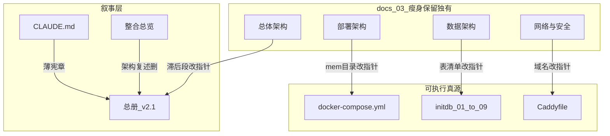

# 五类 56 文档 · 合并去重方案

> **日期**：2026-10-24  
> **输入集**：[`_inventory/five-cat-latest-only-2026-10-24.md`](_inventory/five-cat-latest-only-2026-10-24.md)（总体方案 2 + 规划 4 + 架构 23 + 双站项目 16 + 字段定义 11 = **56**；内容链仅 V5）  
> **本文件职责**：标出重叠簇、Canonical（真源家）、并入/瘦身/降级指令。  
> **不做**：不删改任何原文；不改 [`文档整合与清理建议.md`](文档整合与清理建议.md)；不改 SQL / Compose / Caddy / 站点文件。

---

## 1. 目的与约束

1. 56 份内存在「同主题多处复述」与「叙事数字漂移」；本方案规定**每主题只维护一处全文**，其余改指针或降权。
2. **分层**：可执行真源（`docker-compose*.yml`、`Caddyfile`、`initdb/*.sql`、`sites/**`、工作流 JSON）≠ 叙事 Markdown；**SQL 永不并入 Markdown**，字典与 SQL 冲突时以 SQL 为准。
3. 处置标签：`真源` / `瘦身保留` / `衍生只读` / `维度保留` / `v3快照降权`（见 §6 附录）。

---

## 2. 重叠簇总表（节名证据 + 漂移数字）

| 簇 | 重叠主题 | 主要出现位置 | 关键漂移 / 重合度 |
|---|---|---|---|
| **A** | 双站定位、五红线、目录树、容器矩阵 | 总册 §1/§3/§7.1/§8.1；`CLAUDE.md` §1–§3；整合总览 §2–§3 | 总册 §8.1 与 §2/§3.1 内存数字偶有内部不一致；**以 Compose + CLAUDE §3（1.94GB）为准** |
| **B** | 总体/部署/数据/网络安全分册 vs 总册+现网 | `docs/03` 四篇；总册 §3–§4/§7–§8 | 部署 §3.2 **3072m**、目录 initdb **01~06**；总体/网络偏 **五子域**；数据写 **三 Schema** — 均滞后于 v2.1 |
| **C** | ADR 决策 vs 总册/分册复述 | ADR-0001/0003–0009；总册对应节 | 决策理由只应在 ADR；主文禁止抄「背景/替代方案」长文 |
| **D** | 六容器、三网、路由 | Compose；Caddyfile；部署/总体/网络叙述 | 数值与路由**仅**以 Compose / Caddyfile 为准 |
| **E** | 表/触发器/视图 | initdb 02–09；三字典；触发器与视图.md | 视图行为在触发器文档与字典 § 重复；对象总表宜单点 |
| **F** | V5 规则、总账、阶段、待办 | 方案-v5；执行报告；交接；仪表板 HTML | 报告/交接/仪表板总账高重合；报告 §8/§12「WebP 未做」vs 交接 §9「缩略图完成」 |
| **G** | 盘点分区 / 去重机读 | sync-v5.json + 3×CSV；summary；duplicate-summary | CSV ≡ JSON 切片；summary/duplicate 为 **v3 时代快照**，勿与 V5 执行数字混用 |
| **H** | 目标 / 范围 / 任务 / 日历 | 章程；范围；WBS；时间线 | 章程↔范围约 40% 同义；WBS L0–L6 ↔ 时间线 D0–D5 高重叠 |
| **I** | 门户 HTML / 公私 JSON / n8n | `sites/**`；workflow-03 | 公私 JSON 为脱敏双包，禁止合并 |

---

## 3. 逐簇合并指令

### 簇 A · 宪章与总叙事

| 角色 | 路径 |
|---|---|
| **Canonical（人类全文）** | [`莫伯双站系统全栈架构与部署总册-v2.1.md`](莫伯双站系统全栈架构与部署总册-v2.1.md) |
| **Canonical（智能体红线）** | [`CLAUDE.md`](../../CLAUDE.md) §3（字面与 `mem_limit` 对齐 Compose）；§1/§2 保持薄摘要并链总册 §1/§7.1 |
| **瘦身保留** | [`双站规划文档整合总览.md`](双站规划文档整合总览.md) |

**指令**

- 整合总览：**删/缩**与总册/CLAUDE 重复的 §2、§3.1–§3.3、§5 架构复述。
- **保留**：§1 文档宇宙地图；**§4 门户 IA**（总册无同等模块表，独有）；§6 内容链；§7–§10 任务/缺口/批注/索引。
- 总册内部：§8.1 红线表与 §2/§3.1 容器数字**只维护一处**，另一处改「见 §x / Compose」。

**不可丢失**：总册 §1.3 本期不做、§8.2 合规；整合总览 §8 G1–G8 缺口；CLAUDE §4–§5 智能体分工与交接铁律（不必并入总册）。

---

### 簇 B · docs/03 四篇（不整篇废弃）

| 文件 | 滞后段 → 指针 | 保留独有（继续活跃辅读） |
|---|---|---|
| [`总体架构.md`](../03-架构设计/总体架构.md) | §3.1 五子域、§3.3「三 Schema」→ 总册 §3/§4 + ADR-0007/0008 | §2 C4、§4 mermaid 数据流、§6 故障、§7 演进 |
| [`部署架构.md`](../03-架构设计/部署架构.md) | §2 目录（01~06 / 缺 sites）、§3.2 **3072m** → Compose + CLAUDE §2/§3 | §4 发布/回滚、§5 本地开发、§6 console、§7 检查清单 |
| [`数据架构.md`](../03-架构设计/数据架构.md) | §2 缺 capital 的表清单 → 总册 §4.1 + 三字典 + initdb | §1 存储分层、§3 B 域 ER、§5 生命周期、§7 幂等、§10 容量 |
| [`网络与安全架构.md`](../03-架构设计/网络与安全架构.md) | §2 域名五子域 → ADR-0007 + Caddyfile | §3 端口矩阵、§5 安全头、§8 威胁模型、§9 验收 curl/ss |

**数值/拓扑 Canonical**：`docker-compose.yml` + `deploy/caddy/Caddyfile` + 总册对应章。  
**决策 Canonical**：相关 ADR（见簇 C）。

---

### 簇 C · ADR 决策链

| ADR | Canonical 议题 | 主文只留 |
|---|---|---|
| [0001](../01-项目治理/决策记录/ADR-0001-单机双库与Schema隔离.md) | 双库隔离 | 总册 §4 一行 + 链 |
| [0003](../01-项目治理/决策记录/ADR-0003-n8n子域与数据Schema.md) | n8n 子域与 Schema | 总册 §5 / 网络篇一行 |
| [0004](../01-项目治理/决策记录/ADR-0004-备份与灾备.md) | 备份 RPO/RTO、Restic | 总册 §7.3 |
| [0005](../01-项目治理/决策记录/ADR-0005-中文检索与向量维度.md) | trgm / vector(1536) | 总册 §4.4 |
| [0006](../01-项目治理/决策记录/ADR-0006-安全与鉴权基线.md) | 鉴权基线 | 总册 §8 + 网络篇 |
| [0007](../01-项目治理/决策记录/ADR-0007-双主域拓扑与静态门户三级可见性.md) | 双主域 + 三级可见性 | 总册 §1/§6；**取代 ADR-0002**（已不在 56 集） |
| [0008](../01-项目治理/决策记录/ADR-0008-db_mobobrain增设capital-schema.md) | capital Schema | 总册 §4.1 |
| [0009](../01-项目治理/决策记录/ADR-0009-公私域物理脱敏与HITL发布闸门.md) | 脱敏 + HITL | 总册 §5.4/§6.3；可执行另见 exporters |

**指令**：禁止在总册/整合总览/docs/03 再抄 ADR「背景 / 替代方案 / 后果」全文。

---

### 簇 D · 编排与网关（可执行）

| 角色 | 路径 |
|---|---|
| **真源** | [`docker-compose.yml`](../../docker-compose.yml) |
| **覆盖层（维度保留）** | `docker-compose.local.yml`、`docker-compose.wsl.yml` |
| **真源** | [`deploy/caddy/Caddyfile`](../../deploy/caddy/Caddyfile) |

**指令**：不并入任何 Markdown；叙事只写路径引用。

---

### 簇 E · Schema ↔ 字典

| 角色 | 路径 |
|---|---|
| **可执行真源** | `deploy/postgres/initdb/01`–`09.sql` + `migrations/` |
| **人读 · A（intel/n8n）** | [`网站A数据字典.md`](../04-数据库设计/网站A数据字典.md) ← 镜像 `04` |
| **人读 · B（archive）** | [`网站B数据字典.md`](../04-数据库设计/网站B数据字典.md) ← 镜像 `02` |
| **人读 · 资本** | [`莫伯资本数据字典.md`](../04-数据库设计/莫伯资本数据字典.md) ← 镜像 `05`–`07` |
| **视图/触发器行为** | [`触发器与视图.md`](../04-数据库设计/触发器与视图.md) ← `03`/`06`/`09` + 视图用法 |
| **术语（维度保留）** | [`术语表.md`](术语表.md) — 与字典几乎无字段级重复，**不合并** |

**SQL ↔ 文档对照**

| SQL | 主镜像文档 |
|---|---|
| `02-archive-schema.sql` | 网站 B 字典 §2–§9 |
| `03-archive-triggers.sql` | 触发器与视图 §1.1–§1.4 |
| `04-mobobrain-schema.sql` | 网站 A 字典 §2–§7 |
| `05-mobocapital-schema.sql` | 莫伯资本字典 §2–§9、§12 前部 |
| `06-mobocapital-nav-and-triggers.sql` | 资本字典 §5；触发器 §1.6 |
| `07-mobocapital-terminal-schema.sql` | 资本字典 §10–§12 后部 |
| `08-indexes-grants.sql` | 三字典索引行（grant 细节以 SQL 为准） |
| `09-updated-at-triggers.sql` | 触发器与视图 §1.5 |

**指令**：字典视图节改为摘要 + 链 `触发器与视图.md`；三字典**互不合并**（分工不同）；`数据架构.md` 不另立第三套表清单。

---

### 簇 F · V5 内容链（4 份）

| 角色 | 路径 |
|---|---|
| **策略真源** | [`莫伯双站原件保全与双站同步方案-v5.md`](../07-原始资料/莫伯双站原件保全与双站同步方案-v5.md) |
| **As-built 真源** | [`莫伯双站V5执行报告-2026-10-23.md`](../07-原始资料/莫伯双站V5执行报告-2026-10-23.md) |
| **瘦身保留** | [`莫伯双站V5-新会话交接-2026-10-23.md`](../07-原始资料/莫伯双站V5-新会话交接-2026-10-23.md) |
| **衍生只读** | [`莫伯双站V5执行仪表板-2026-10-23.html`](../07-原始资料/莫伯双站V5执行仪表板-2026-10-23.html) |

**指令**

- 交接：**保留** §3 路径、§4 纪律、§7 校验、§8 开场提示词、§9 附录；§1–§2 / §5–§6 总账与待办改为「见执行报告 §x」。
- 仪表板：不当第二报告；活跃阅读以执行报告为准（可视化留盘）。
- **本方案仅记录、本轮不改正文**：报告应吸收交接 §9 缩略图结论；执行期数字以金库 `00-INDEX`（`COUNTS.json` 等，集外）为准。

**不可丢失**

- 仅方案：§1 要求映射、§3 People/课件、§5 上传示例、§11 八开关、§13 机读索引  
- 仅报告：§3 方案 vs 实际、§6 站点分流、§7 密钥、§11 重复组、§13 与 v3/v4  
- 仅交接：30 秒校验脚本、开场模板、§9 最新队列  
- 仅仪表板：分区/六分片可视化结构  

---

### 簇 G · 盘点机读 6 件

| 角色 | 路径 |
|---|---|
| **规划期真源** | `docs/07-原始资料/资产盘点数据-2026-10-22/sync-v5.json` |
| **衍生只读** | `sync-v5-category.csv`、`sync-v5-local.csv`、`sync-v5-p2.csv`（≡ JSON 扁平导出） |
| **v3 快照降权** | `summary.json`、`duplicate-summary.json` |

**指令**：指导开发读 `sync-v5.json`；CSV 可不读；summary/duplicate **勿与 V5 执行数字混用**（执行真源在金库索引，集外）。  
**可保留独有**：summary 的 16 顶层目录长尾；duplicate 的 `by_ext`；p2 CSV 的二级路径排名（若不用 JSON 内 `sync.p2`）。

---

### 簇 H · 规划四件套（不合并文件）

| 维度 | Canonical | 指令 |
|---|---|---|
| In/Out / MVP 分层 | [`范围与边界.md`](../01-项目治理/范围与边界.md) | 边界图、数据边界、验收边界 |
| 目标 / 成功标准 / 干系人 | [`项目章程.md`](../01-项目治理/项目章程.md) | §4 范围改为「详见范围与边界」短段 |
| 任务 ID / DoD / 状态 | [`里程碑与WBS.md`](../01-项目治理/里程碑与WBS.md) | **唯一任务清单** |
| 日历 / 工时 / Go-NoGo | [`开发部署任务执行时间线.md`](../01-项目治理/开发部署任务执行时间线.md) | 不复制 WBS 长表；保留 §8 映射 |

**不可丢失**：章程成功标准与批准；范围 OSS 双桶与验收边界；WBS E0/T01–T16 与 L0–L6；时间线每日节奏、AI 分工、质量门引用。

---

### 簇 I · 站点与工作流

| 角色 | 路径 |
|---|---|
| **真源 · 门户** | `sites/mobocapital/index.html`、`sites/mobohome/index.html` |
| **真源 · 数据包** | `sites/**/data/*.json`、`sites/**/internal/*.json`（公私双包，**禁止合并**） |
| **真源 · n8n** | `workflows/workflow-03-mobocapital-1plus3.template.json`；总册 §5 只引用 |

**说明**：脱敏设计要求 public 与 internal 并存；总册 §6 技术叙述，门户 IA 见整合总览 §4。

---

## 4. 合并后建议活跃阅读集（约 40–45 路径）

### 4.1 必读叙事

- 总册 v2.1、`CLAUDE.md`、整合总览（按簇 A 瘦身后）
- 章程、范围、WBS、时间线
- 方案-v5、V5 执行报告、V5 交接（瘦身后）
- ADR-0001 / 0003–0009
- 术语表、网站 A/B 字典、莫伯资本字典、触发器与视图
- docs/03 四篇：**辅读独有节**（滞后段视为已指针化）

### 4.2 必读可执行真源

- `docker-compose.yml` + local + wsl  
- `deploy/caddy/Caddyfile`  
- `deploy/postgres/initdb/01`–`09.sql`、`migrations/202610200001__schema_migrations.sql`  
- `sites/mobocapital|mobohome` 的 HTML 与 JSON  
- `workflows/workflow-03-mobocapital-1plus3.template.json`  
- `sync-v5.json`

### 4.3 衍生 / 降权（留盘，默认不指导开工）

- V5 执行仪表板 HTML  
- `sync-v5-*.csv` ×3  
- `summary.json`、`duplicate-summary.json`（v3 快照）

---

## 5. 明确不做

1. 不删除、不改写本方案点名的任何原文（含 SQL/Compose/站点）。  
2. 不修改 [`文档整合与清理建议.md`](文档整合与清理建议.md)。  
3. 不把已剔出的 v1–v4 内容链、server-sync 镜像、ADR-0002、Autopilot 并回活跃集。  
4. 本文件是**合并指令说明书**；真正改段落属于后续「执行合并」任务。

---

## 6. 附录：56 路径处置标签

| # | 路径 | 标签 | 簇 |
|---:|---|---|---|
| 1 | `docs/00-总册/莫伯双站系统全栈架构与部署总册-v2.1.md` | 真源 | A |
| 2 | `docs/00-总册/双站规划文档整合总览.md` | 瘦身保留 | A |
| 3 | `docs/01-项目治理/项目章程.md` | 维度保留 | H |
| 4 | `docs/01-项目治理/范围与边界.md` | 真源（范围维） | H |
| 5 | `docs/01-项目治理/里程碑与WBS.md` | 真源（任务维） | H |
| 6 | `docs/01-项目治理/开发部署任务执行时间线.md` | 维度保留 | H |
| 7 | `CLAUDE.md` | 真源（智能体） | A |
| 8 | `docker-compose.yml` | 真源 | D |
| 9 | `docker-compose.local.yml` | 维度保留 | D |
| 10 | `docker-compose.wsl.yml` | 维度保留 | D |
| 11 | `deploy/caddy/Caddyfile` | 真源 | D |
| 12 | `deploy/postgres/initdb/01-init-dual-db.sql` | 真源 | E |
| 13 | `deploy/postgres/initdb/02-archive-schema.sql` | 真源 | E |
| 14 | `deploy/postgres/initdb/03-archive-triggers.sql` | 真源 | E |
| 15 | `deploy/postgres/initdb/04-mobobrain-schema.sql` | 真源 | E |
| 16 | `deploy/postgres/initdb/08-indexes-grants.sql` | 真源 | E |
| 17 | `deploy/postgres/initdb/09-updated-at-triggers.sql` | 真源 | E |
| 18 | `migrations/202610200001__schema_migrations.sql` | 真源 | E |
| 19 | `docs/03-架构设计/总体架构.md` | 瘦身保留 | B |
| 20 | `docs/03-架构设计/部署架构.md` | 瘦身保留 | B |
| 21 | `docs/03-架构设计/数据架构.md` | 瘦身保留 | B |
| 22 | `docs/03-架构设计/网络与安全架构.md` | 瘦身保留 | B |
| 23 | `docs/01-项目治理/决策记录/ADR-0001-…` | 真源 | C |
| 24 | `docs/01-项目治理/决策记录/ADR-0003-…` | 真源 | C |
| 25 | `docs/01-项目治理/决策记录/ADR-0004-…` | 真源 | C |
| 26 | `docs/01-项目治理/决策记录/ADR-0005-…` | 真源 | C |
| 27 | `docs/01-项目治理/决策记录/ADR-0006-…` | 真源 | C |
| 28 | `docs/01-项目治理/决策记录/ADR-0008-…` | 真源 | C |
| 29 | `docs/01-项目治理/决策记录/ADR-0009-…` | 真源 | C |
| 30 | `docs/01-项目治理/决策记录/ADR-0007-…` | 真源 | C |
| 31 | `deploy/postgres/initdb/05-mobocapital-schema.sql` | 真源 | E |
| 32 | `deploy/postgres/initdb/06-mobocapital-nav-and-triggers.sql` | 真源 | E |
| 33 | `deploy/postgres/initdb/07-mobocapital-terminal-schema.sql` | 真源 | E |
| 34 | `docs/07-原始资料/莫伯双站原件保全与双站同步方案-v5.md` | 真源 | F |
| 35 | `docs/07-原始资料/莫伯双站V5执行报告-2026-10-23.md` | 真源 | F |
| 36 | `docs/07-原始资料/莫伯双站V5-新会话交接-2026-10-23.md` | 瘦身保留 | F |
| 37 | `docs/07-原始资料/莫伯双站V5执行仪表板-2026-10-23.html` | 衍生只读 | F |
| 38 | `sites/mobocapital/index.html` | 真源 | I |
| 39 | `sites/mobocapital/data/public-data.json` | 真源 | I |
| 40 | `sites/mobocapital/data/terminal-snapshot.json` | 真源 | I |
| 41 | `sites/mobocapital/internal/internal-data.json` | 真源 | I |
| 42 | `sites/mobohome/index.html` | 真源 | I |
| 43 | `sites/mobohome/data/public-home-data.json` | 真源 | I |
| 44 | `sites/mobohome/internal/internal-home-data.json` | 真源 | I |
| 45 | `workflows/workflow-03-mobocapital-1plus3.template.json` | 真源 | I |
| 46 | `docs/00-总册/术语表.md` | 维度保留 | E |
| 47 | `docs/04-数据库设计/网站A数据字典.md` | 真源（人读） | E |
| 48 | `docs/04-数据库设计/网站B数据字典.md` | 真源（人读） | E |
| 49 | `docs/04-数据库设计/莫伯资本数据字典.md` | 真源（人读） | E |
| 50 | `docs/04-数据库设计/触发器与视图.md` | 真源（行为） | E |
| 51 | `…/资产盘点数据-2026-10-22/summary.json` | v3快照降权 | G |
| 52 | `…/duplicate-summary.json` | v3快照降权 | G |
| 53 | `…/sync-v5.json` | 真源（规划期） | G |
| 54 | `…/sync-v5-category.csv` | 衍生只读 | G |
| 55 | `…/sync-v5-local.csv` | 衍生只读 | G |
| 56 | `…/sync-v5-p2.csv` | 衍生只读 | G |

**标签计数（指导阅读优先级，非删除计数）**

| 标签 | 约计 |
|---|---:|
| 真源 | 38 |
| 瘦身保留 | 6 |
| 维度保留 | 6 |
| 衍生只读 | 4 |
| v3快照降权 | 2 |
| **合计** | **56** |

---

## 7. 结论

九簇重叠已定 Canonical：架构叙事归总册 + CLAUDE，分册只留独有 SOP/图/威胁；决策归 ADR；运行时归 Compose/Caddy/SQL；内容归方案-v5 + 执行报告；字段人读归三字典 + 触发器文档；规划四维分文件保留。下一步若执行合并，按本文件 §3 改段落即可，**原文删除不在本方案范围内**。
