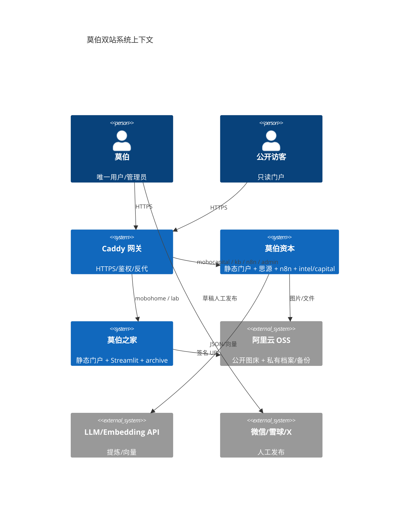
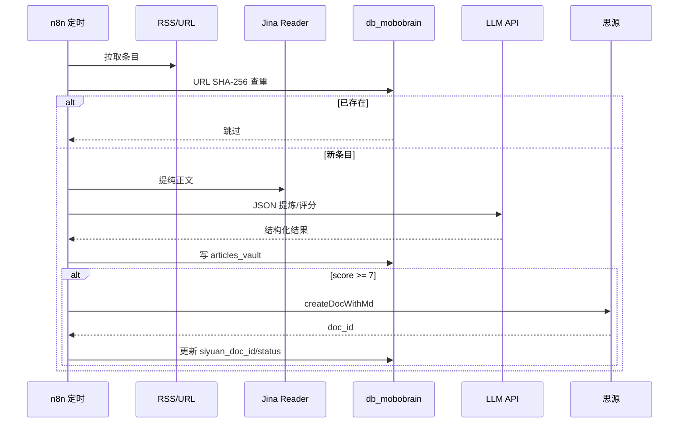
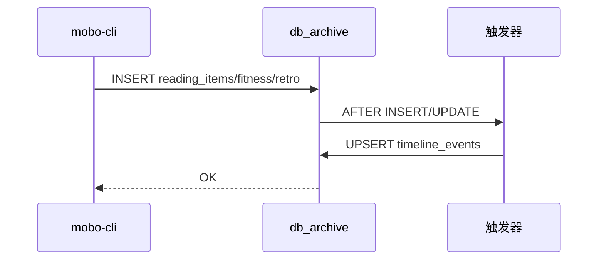

# 总体架构

> **合并去重（簇 B）**：容器限额、双主域入口、四 Schema 数值与拓扑真源见  
> [`docker-compose.yml`](../../docker-compose.yml)、[`deploy/caddy/Caddyfile`](../../deploy/caddy/Caddyfile)、  
> [总册 v2.1](../00-总册/莫伯双站系统全栈架构与部署总册-v2.1.md) §3–§4、[`CLAUDE.md`](../../CLAUDE.md)。  
> 本篇保留原则、C4/时序图、故障与演进；滞后「五子域 / 三 Schema」叙述已改为指针。

## 1. 目标与原则

在 2C4G 单机上，以最小运行时成本提供两个逻辑独立的网站：

1. **安全边界优先**：公开与私有分离，所有后台强认证。
2. **数据可恢复**：数据库逻辑备份 + 文件卷 + 配置；恢复可验证。
3. **内存可控**：六个容器，硬上限，构建外置，重计算外置。
4. **冷热分层**：原片进 OSS 低频/归档，缩略图留标准层。
5. **可演进**：单机可平滑拆分为多机；数据库可按库迁移。

## 2. 上下文



入口与鉴权细节见 [ADR-0007](../01-项目治理/决策记录/ADR-0007-双主域拓扑与静态门户三级可见性.md) 与 `Caddyfile`。

## 3. 逻辑组件

### 3.1 边缘层

- **Caddy 2.9**：TLS、HTTP/2/3、BasicAuth、安全头、反代、静态分发。
- **现行入口**：双主域（`mobocapital` / `mobohome`）+ 生产力子域（`kb` / `n8n` / `lab` / `admin`）+ `/internal/*` 守卫。  
  （旧文「www/archive 五子域」口径已废止，见 ADR-0007。）
- 不承担业务逻辑；不做数据库连接。

### 3.2 应用层

| 组件 | 职责 | 状态 |
|---|---|---|
| 思源笔记 | 知识库、双链、编辑、搜索 | 有状态（卷） |
| n8n | 采集、LLM、思源推送、草稿合成 | 有状态（卷 + PG） |
| Streamlit | 个人档案分析看板 | 无状态（读 PG/OSS） |
| 静态操作台 | 任务/入口/状态展示 | 无状态（静态） |
| 双站静态门户 | 资本 / 之家预生成 JSON | 无状态（静态） |

### 3.3 数据层

- **PostgreSQL 16 + pgvector**：双库、**四 Schema**（`intel` / `capital` / `n8n` / `archive`）、触发器、视图、HNSW。  
  表清单见总册 §4.1、`docs/04-数据库设计/` 与 `deploy/postgres/initdb/`。
- **OSS 公开 / 私有 Bucket**、本地卷：见总册 §1 / §3。

### 3.4 运维层

- **restic-backup**：每日 dump + 卷 + 配置，加密上传 OSS（决策见 [ADR-0004](../01-项目治理/决策记录/ADR-0004-备份与灾备.md)）。
- **主机脚本**：Swap、Docker、ufw、fail2ban、日志轮转、监控。
- **外部监控**：uptime、证书到期、磁盘/容器告警。

## 4. 关键数据流

正文步骤与对齐总册 §3.3 / §5；下列 mermaid 为独有可视化。

### 4.1 采集 → 思源



### 4.2 档案写入 → 时间线



### 4.3 看板读取

- Streamlit 用只读账号连接 `db_archive`。
- 查 `v_weekly_life_analytics`、`timeline_events`、`archive_assets`。
- 私有文件通过 OSS 签名 URL 下载，不暴露 Bucket。
- 断库时切 52 周合成沙盒，保证演示/开发。

## 5. 运行时拓扑

```text
Host (2C4G, Ubuntu)
├─ edge_net (bridge)
│  └─ caddy :80/:443
├─ internal_net (internal: true)
│  ├─ postgres :5432 (宿主机 127.0.0.1)
│  ├─ mobobrain-pkm
│  ├─ mobobrain-n8n
│  ├─ archive-dashboard
│  └─ restic-backup
└─ egress_net
   ├─ mobobrain-n8n
   ├─ archive-dashboard
   └─ restic-backup
```

网络分层说明与成员名单以 `docker-compose.yml` 与 [部署架构.md](部署架构.md) §3.1 为准（本处不维护第二套 mem/端口表）。

## 6. 故障模式

| 故障 | 影响 | 处理 |
|---|---|---|
| Caddy 挂 | 全部入口不可用 | `docker compose restart caddy`；检查证书/端口 |
| Postgres 挂 | 双站数据不可用 | 重启；检查 OOM/磁盘；必要时恢复 |
| 思源挂 | 知识库不可用；n8n 推送失败 | 重启；n8n 标记待重推 |
| n8n 挂 | 自动化停止；双站仍可读 | 重启；补跑 |
| Streamlit 挂 | 看板不可用 | 重启；不影响数据 |
| OSS 不可用 | 上传/下载/备份失败 | 重试；检查 AK/网络/余额 |
| 主机磁盘满 | 全部异常 | 清日志/镜像/dump；扩容 |

## 7. 演进路径

- **拆分网站 B**：把 Streamlit + `db_archive` 迁到独立 2C4G；OSS 不变。
- **拆分数据库**：把 `db_archive` 迁到独立 PostgreSQL；连接串切换。
- **公开站 CDN**：静态站放 OSS + CDN，Caddy 只做后台入口。
- **多用户**：引入 Authelia/TOTP、RLS、审计；当前不做。
