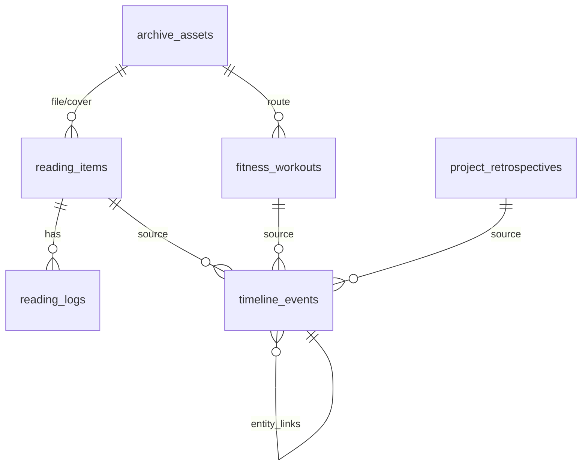
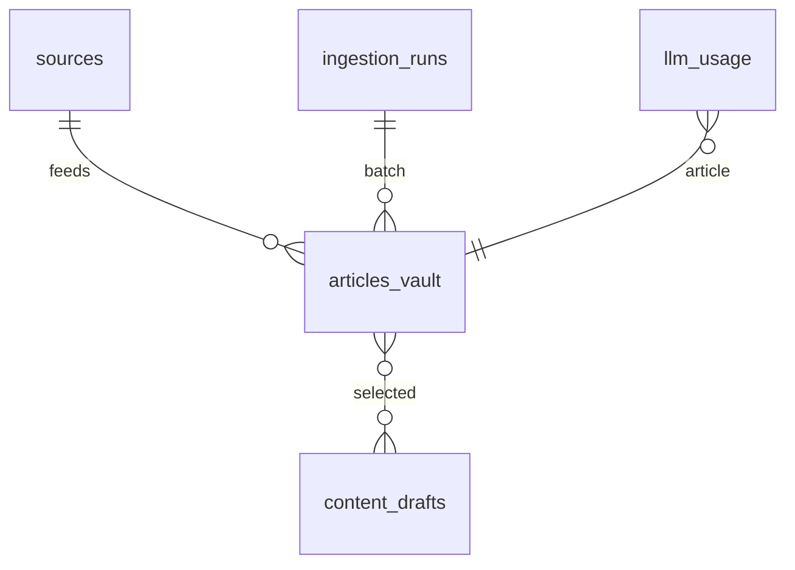

# 数据架构

## 1. 存储分层

```text
热数据（PostgreSQL）
  ├─ db_mobobrain.intel.*  文章、草稿、采集运行、LLM 用量
  ├─ db_mobobrain.n8n.*    n8n 自身表
  └─ db_archive.archive.*  时间线、阅读、运动、复盘、资产元数据

温数据（OSS 标准/低频）
  ├─ thumbnails/           800px WebP 缩略图
  ├─ scan_doc/             研报 PDF/合同（90 天转 IA）
  └─ photo/                原片（30 天 IA，180 天 Archive）

冷数据（OSS 归档）
  ├─ video/                视频（7 天 Archive，注意最低存储期）
  └─ restic-cold-backup/   Restic 加密备份（30 天 IA，禁止 Archive）
```

## 2. 数据库与 Schema

| 数据库 | Schema | 属主 | 主要表 |
|---|---|---|---|
| `db_mobobrain` | `intel` | `user_mobobrain` | `sources`、`articles_vault`、`content_drafts`、`ingestion_runs`、`llm_usage` |
| `db_mobobrain` | `n8n` | `user_n8n` | n8n 内部表 |
| `db_archive` | `archive` | `user_archive` | `timeline_events`、`entity_links`、`reading_items`、`reading_logs`、`fitness_workouts`、`fitness_biometrics`、`project_retrospectives`、`archive_assets` |

## 3. 网站 B 实体关系



> `entity_links` 是弱关联（from_type/from_id → to_type/to_id），不加外键，避免多态表的复杂性；由应用保证一致性。

### 3.1 统一时间线

`timeline_events` 是网站 B 的“时间脊柱”：

- `occurred_at` / `ended_at` / `time_span TSTZRANGE`
- `domain`：职业、投资、学习、健康、家庭、系统
- `event_type`：`BOOK_FINISHED`、`WORKOUT_RUNNING`、`RETRO_WEEKLY` 等
- `source_table` + `source_id`：幂等来源
- `metrics_payload JSONB`：各模块指标
- `importance_score` / `energy_impact`
- `privacy`

### 3.2 阅读

- `reading_items`：书目、状态、评分、页数、标签、文件/封面资产。
- `reading_logs`：会话、页码、时长、摘录、批注、向量。
- 触发器：书目 COMPLETED → 汇总时长/笔记 → 时间线；日志变更 → 刷新统计。

### 3.3 运动

- `fitness_workouts`：类型、时长、心率、RPE、距离、配速、力量容量、动作 JSONB。
- `fitness_biometrics`：每日体重、体脂、静息心率、HRV、睡眠、步数、主观能量。
- 触发器：训练 → 时间线；高强度/长距离提升重要性。

### 3.4 复盘

- `project_retrospectives`：四段论（假设/执行/归因/原则）、KPI、行动项、评分、向量。
- 触发器：周期事件 → 时间线；摘要含原则迭代/偏差归因。

### 3.5 资产

- `archive_assets`：SHA-256 唯一、OSS Key、缩略图、层级、加密标记、文本、向量、媒体元数据。
- 引用计数/软删除用于安全 GC（P1）。

## 4. 网站 A 实体关系



- `sources`：RSS/URL 源、分类、启用、抓取间隔。
- `articles_vault`：URL、SHA-256、正文、摘要、命题、论据、二阶推演、情绪/价值分、标签、向量、思源 doc_id、状态。
- `content_drafts`：平台、标题、正文、meta、来源文章数组、状态、模型/token/成本。
- `ingestion_runs`：每次采集的统计与错误。
- `llm_usage`：模型、token、成本，用于预算。

## 5. 数据生命周期

| 阶段 | 网站 A | 网站 B |
|---|---|---|
| 采集/写入 | RSS/URL → 提纯 → LLM → 入库 | CLI/API → 业务表 → 触发器 |
| 加工 | 评分、标签、向量、思源双链 | 时间线聚合、周视图、资产分层 |
| 使用 | 搜索/阅读/草稿 | 看板/回归/复盘 |
| 归档 | 低分文章保留但不再推送 | 原片 IA/Archive；缩略图标准层 |
| 删除 | 软删除/标记 | 资产软删除 + GC；时间线触发器清理 |
| 备份 | pg_dump + 配置 | pg_dump + 卷 + OSS |

## 6. 检索设计

| 场景 | 方案 | 索引 |
|---|---|---|
| 英文全文 | `to_tsvector('simple')` / `english` | GIN |
| 中文标题/摘要 | `pg_trgm` + `ILIKE` | GIN trgm |
| 中文正文 | 应用侧 jieba 写入 tsvector（P1） | GIN |
| 标签 | `TEXT[]` | GIN |
| 时间区间 | `TSTZRANGE` | GiST |
| 语义 | pgvector | HNSW cosine |
| JSONB 指标 | `metrics_payload` | GIN |

## 7. 一致性与幂等

- 触发器使用 `INSERT ... ON CONFLICT (source_table, source_id) DO UPDATE`。
- 删除源记录时删除对应时间线节点。
- 状态回退（COMPLETED → READING）删除节点。
- 阅读日志变更刷新时长/笔记数。
- n8n 以 `url_hash` 唯一约束保证去重；重复投递不重复调用 LLM。
- 资产以 `sha256_hash` 唯一；重复上传走秒传。

## 8. 数据保留与隐私

| 数据 | 保留 | 说明 |
|---|---|---|
| 文章库 | 长期 | 可标记归档；不物理删除 |
| 草稿 | 长期 | 发布后可归档 |
| 时间线 | 长期 | 个人档案核心 |
| 原始照片/视频 | 长期/按需 | OSS 分层；可手动删除 |
| 备份 | 日7/周4/月6 | Restic forget |
| 日志 | 30 天 | Docker 轮转 + 外部日志可选 |

隐私等级：

- `PUBLIC`：公开专栏内容。
- `RESTRICTED`：可分享但非公开。
- `PRIVATE`：默认个人数据。
- `VAULT`：高敏；应用层加密/额外保护（P1）。

## 9. 备份与恢复的数据视图

- **数据库**：`pg_dump -Fc` 双库 + `pg_dumpall --globals-only`。
- **文件**：思源工作区、n8n 数据、Caddy 配置、Compose/Caddyfile/脚本。
- **不备份**：`pg_data`、证书（可重签）、临时 dump。
- **恢复粒度**：单库、单卷、整机。
- **校验**：恢复后核心表计数、触发器存在、视图可查、看板可打开。

## 10. 容量估算

| 数据 | 1 年 | 2 年 | 备注 |
|---|---:|---:|---|
| 文章文本 | 1–5GB | 2–10GB | PDF 为主 |
| 思源工作区 | 2–10GB | 5–20GB | 含附件 |
| 照片原片 | 50–200GB | 100–400GB | OSS 低频/归档 |
| 视频 | 20–100GB | 50–200GB | OSS 归档 |
| 数据库 | 1–5GB | 2–10GB | 含向量/索引 |
| 备份 | 与增量相关 | — | Restic 去重 |

> 以上为规划值；以 `v_asset_storage_summary` 与实际账单校准。
